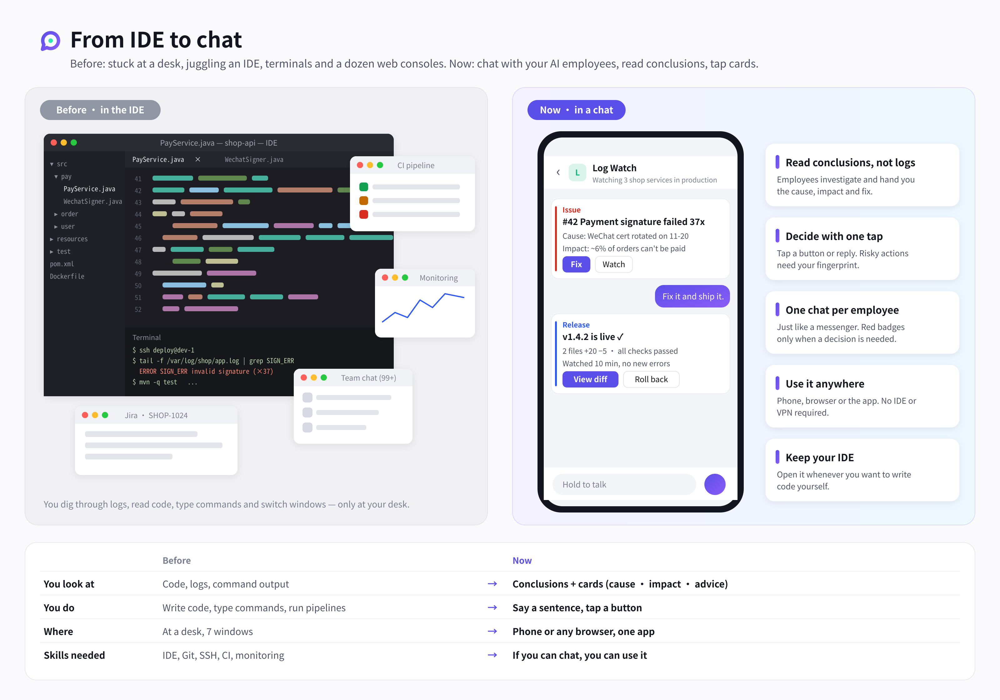
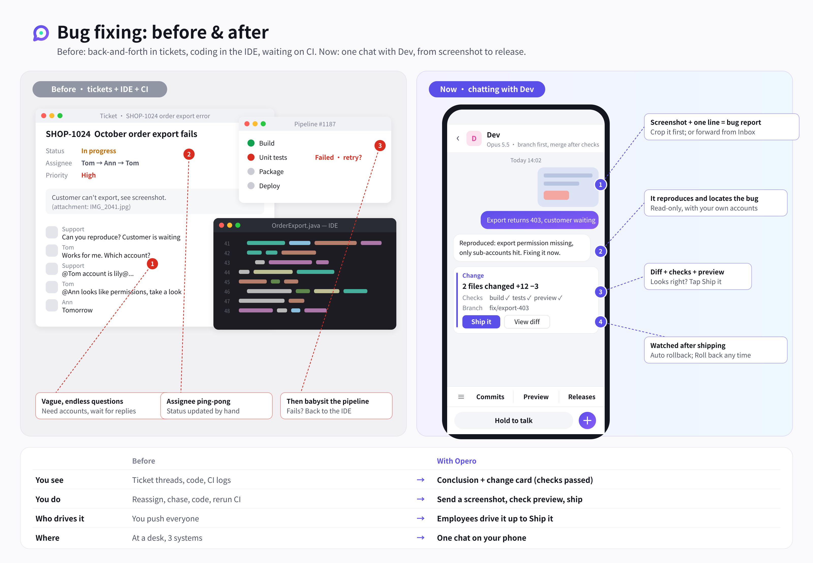
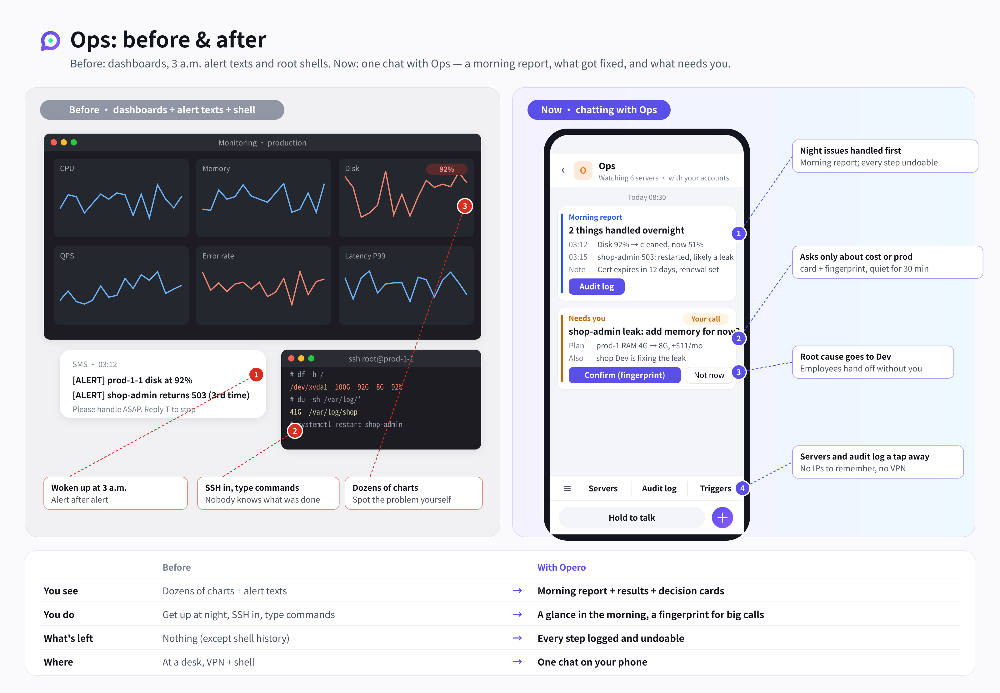
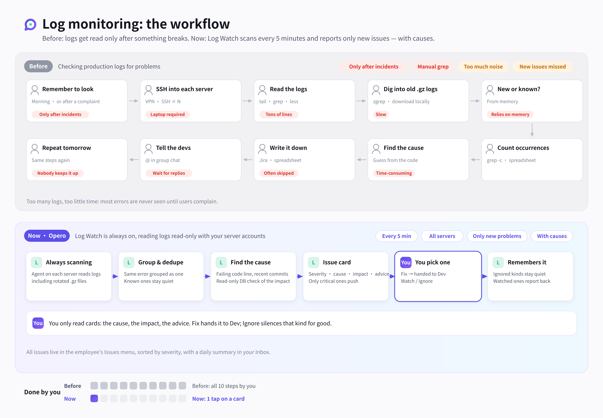
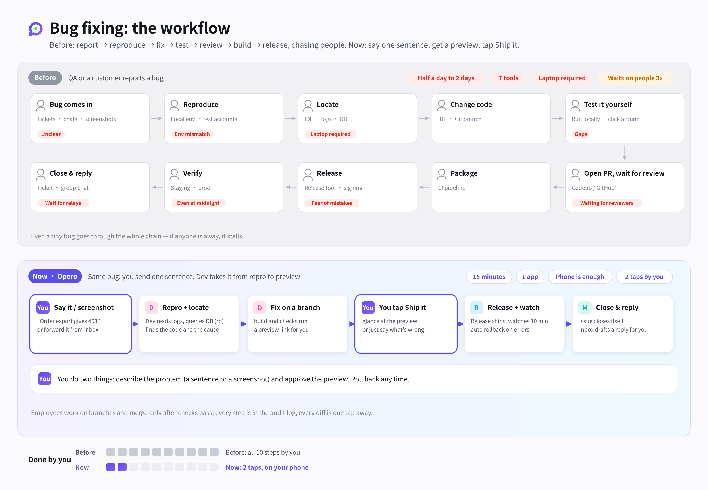

**Your self-hosted AI dev team, in a chat app.**
Claude Code & Codex employees that catch bugs, fix code, ship releases and run ops — all from your phone.

**English** · [简体中文](README.zh-CN.md) · **[Live demo](https://opero.yimaworks.com/demo)** · [Website](https://opero.yimaworks.com)

   


---

Opero is a **self-hosted, single-user AI agent workspace** for developers: a small team of **AI employees** runs your day-to-day engineering — **log monitoring, bug fixing, releases and ops (AI SRE)**. Each employee is a real **coding agent** (Claude Code, Codex, or any ACP agent) running on your own servers with **the access you already have at work**, and you talk to all of them in one chat app — think *a personal AI agent like OpenClaw, but built to ship and operate your code*.

- **One person, one instance.** No accounts, roles or approval chains. Opero is *your* dev team.
- **Your access, brought in.** Whatever servers, repos, databases and cloud accounts you can use at work, your employees can use — nothing more. The AI never sees plaintext secrets; risky actions always need your fingerprint (human-in-the-loop by design).
- **Hackable — built to be forked.** Change menus, add plugins and cards, add themes, write your own employees. Opero's own Dev employee can make those changes for you, with a preview before going live.

## Why Opero




## What changes

Opero doesn't add another dashboard. It replaces the IDE + terminal + dozen web consoles you juggle every day with a chat: **employees investigate and do the work; you read conclusions and make decisions.**

### Log monitoring

Instead of grepping logs after something breaks, the **Log Watch** employee scans every server every 5 minutes, groups and dedupes errors, finds the cause, and sends you an issue card — *Fix*, *Watch* or *Ignore*.


### Bug fixing

Send a screenshot and one sentence. The **Dev** employee reproduces the bug, fixes it on a branch, runs the checks and gives you a preview. You tap *Ship it*; the **Release** employee ships it, watches it, and rolls back automatically if errors go up.



### Ops (AI SRE)

The **Ops** employee watches your servers 24/7. Small things (clean old logs, restart a dead service, renew a certificate) are handled and reported in the morning — every step is undoable. Anything that costs money or touches production waits for your fingerprint.



<details>
<summary><b>The workflows, step by step</b></summary>





</details>

## How it works

| | |
|---|---|
| **Employees** | Each employee is a long-running *work* — a coding agent (Claude Code / Codex / …) on one of your servers — with a role, its own memory repo in git, and bottom-menu shortcuts. When its context fills up it writes a handoff and starts a fresh work; nothing is lost. |
| **Chat + cards** | Employees answer in Markdown and post **cards** (issue, change, release, query, confirm, ask…). A card button is a tool call, so the same card works on web, desktop and mobile. |
| **MCP at the core** | Every tool goes through one gateway (identity → policy → audit → execute) and speaks MCP. Employees delegate work to each other with the same tools you use. |
| **Agent** | A small agent on each server (or your own laptop) connects *outward* — no open ports. It runs the employees and reads logs, metrics and deploy dirs locally. |
| **Safety** | Trust by default, with guard rails: risky actions need your fingerprint (then it stays quiet for 30 minutes), production protection is one switch away, and everything lands in an undoable audit log. |
| **Knowledge** | Your habits are injected into every task; shared specs, API docs and runbooks live in Opero and are queried on demand over MCP; each employee keeps its own notes in its git repo. |

## How Opero compares

| | Opero | Coding-agent remotes<br>(T3 Code, Orca, RemoteCC) | Personal AI agents<br>(OpenClaw, Hermes) | AI SRE agents<br>(HolmesGPT, OpenSRE) | AI workforce platforms<br>(Paperclip, Workforce) |
|---|---|---|---|---|---|
| Drive Claude Code / Codex from your phone | ✅ | ✅ | — | — | — |
| A team of long-running employees with roles and memory | ✅ | — | one assistant | — | ✅ |
| Finds bugs from logs on its own | ✅ | — | — | ✅ | — |
| Fix → checks → release → rollback in one chat | ✅ | partial | — | partial | — |
| Cards with buttons instead of walls of text | ✅ | — | — | — | — |
| Uses *your* existing access, fingerprint for risky actions | ✅ | — | — | partial | approvals |
| Self-hosted, single user, fork-and-hack | ✅ | ✅ | ✅ | ✅ | team-oriented |

## Features

- **Chat like WeChat** — pinned chats, mute, red dots only for things that need your decision, voice input, image editor (crop / rotate / adjust) for every upload.
- **Message assistant** — pulls email, Slack and Telegram into one place, tells you what needs your attention and why, and takes you to the original message. It never replies on your behalf; ask it for a reply suggestion (in any language) and copy it yourself.
- **Per-employee work settings** — model, reasoning effort, approval mode (auto / ask before commands / ask every step / plan only), remembered per employee.
- **Knowledge base & flows** — save what an employee just did as a flow and rerun it without AI; trigger flows on a schedule or a webhook.
- **Servers, releases, data** — server health and read-only commands, releases with rollback, read-only DB queries with snapshots for writes, credentials grouped by what they can do.
- **14 themes + your own colors**, light / dark / follow system, personalized profile header.
- **Android app** — native shell around the web UI with push, fingerprint, notification deep links and in-app updates. New features ship with the web UI, no app update needed.

## Status

Opero is at an **early stage** — we are open-sourcing it while we build it.

- ✅ **Backend v0.1** (`code/server`, Node 22 + TypeScript + SQLite): owner login, real chat with Claude Code / Codex employees (streaming, interjections, stop), the Opero MCP agent proxy (servers over SSH, MySQL / PostgreSQL, Git sync, approval cards, knowledge base, delegation), encrypted vault, scheduled and webhook triggers, audit log, usage, Android shell pairing and push.
- ✅ **Web UI** (`code/web`, React + Vite): the same build is the live demo (mock data) and the real app (served by the backend).
- ✅ **Languages**: 简体中文, 繁體中文, English, 日本語, Deutsch, Français, العربية. Follows the system by default; your choice syncs to every device.
- ✅ **Android shell** (`code/android`, Kotlin): written, not yet released.
- 🚧 **Not yet in v0.1**: releases, message channels (mail / Slack / Telegram), saved flows, plugins, issue tracking, context compaction, voice input. In the installed app these show "coming soon"; the demo shows how they will look.

Most docs are in Chinese for now; English versions will follow.

## Try it

- **Live demo:** [opero.yimaworks.com/demo](https://opero.yimaworks.com/demo) — the full UI on mock data; it connects to nothing.
- **Run the prototype locally:**

```bash
cd code/web
npm install
npm run dev
```

Open the printed URL, log in with the prefilled demo account, and walk through the onboarding (or skip it).

## Install

Opero runs on **your own server**, because employees need a machine to work on. Installing works like the self-hosted forum software of old:

1. Get a Linux server with systemd (Ubuntu / Debian / RHEL family, 2 vCPU / 4 GB+). A domain is recommended.
2. **Let your AI install it.** Open Claude Code or Codex on that server and say:
   > Install Opero on this server by following https://github.com/yimaworks/opero/blob/main/INSTALL.md

   It checks the server, runs the installer, fixes problems and tells you the address. To do it yourself, run as root:
   ```bash
   curl -fsSL https://raw.githubusercontent.com/yimaworks/opero/main/code/server/scripts/install.sh | sudo bash
   ```
   Or, from a clone of this repository: `sudo bash code/server/scripts/install.sh`. See [INSTALL.md](INSTALL.md) for details. Add `--cn` to download Node and npm packages from mirrors in China, and `--with-codex` to install Codex as well.
3. Open `http://<server-ip>:7300`. Create the owner account. The setup wizard then installs Claude Code for you with one click and logs it in (open the login page, authorize, paste the code back), so you never touch a terminal again. Then create your first employees.

What the installer sets up:

| Path / user | What |
|---|---|
| `/opt/opero` | Node 22 and the app |
| `/etc/opero/opero.env` | port, directories, AI user |
| `/var/lib/opero` | database, vault key, files (readable by `opero` only) |
| `/srv/opero/work` | workspaces where employees work |
| user `opero` | runs the backend (`systemctl status opero`) |
| user `opero-ai` | runs Claude Code / Codex. It cannot read `/var/lib/opero`, so the AI never sees your credentials. |

For production, put nginx with HTTPS in front (example: `code/server/scripts/nginx.conf`). Daily commands: `opero status`, `opero logs`, `sudo opero update` (pulls the latest code from GitHub), `opero reset-password`. Everything comes from GitHub, nodejs.org and npm; nothing is downloaded from the Opero website.

**Run it locally for development** (no isolation, so the AI user is your own user):

```bash
cd code/web && npm install && npm run build
cd ../server && npm install && npm start   # http://127.0.0.1:7300
```

## Repository layout

```
code/server          Backend (Node 22, TypeScript run directly, node:sqlite) + installer
code/web             Web UI (React 19 + Vite + TypeScript)
code/android         Android app shell (Kotlin, WebView + push + fingerprint)
code/design-mockups  Scripts that generate the design images and logo
docs/                Specs and design docs (start with docs/设计.md)
deploy/              Build and deploy scripts
```

## Customizing Opero (二开)

Opero is designed to be forked and changed:

- **Bottom menus** — register a menu in `code/web/src/menus.ts`; see `docs/规范/底部菜单.md`.
- **Cards** — one JSON description, one renderer; see `docs/规范/表单与卡片.md`.
- **Themes** — add one entry to `code/web/src/themes.ts`.
- **Data layer** — pages only read from `code/web/src/store.ts`; swap mock data for your API without touching pages.

## Contributing

Issues and pull requests are welcome. Please open an issue first for larger changes.

## Keywords

AI dev team · AI employees · coding agent · Claude Code · Codex · ACP · MCP · personal AI agent · self-hosted · AI SRE · AIOps · ChatOps · human-in-the-loop · agent orchestration · mobile

## License

[Apache-2.0](LICENSE)
