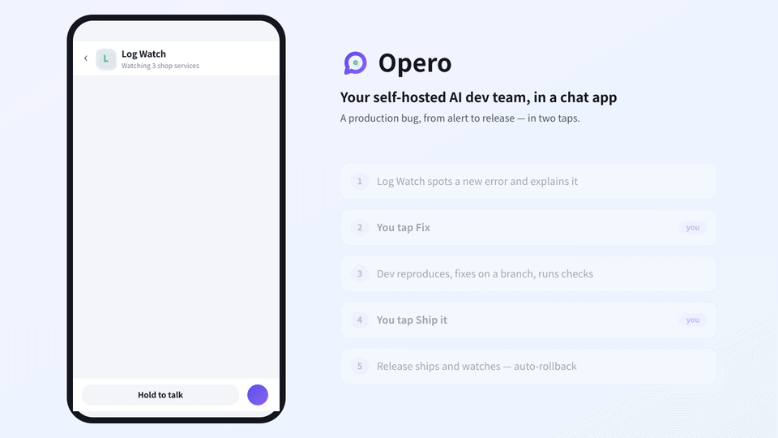
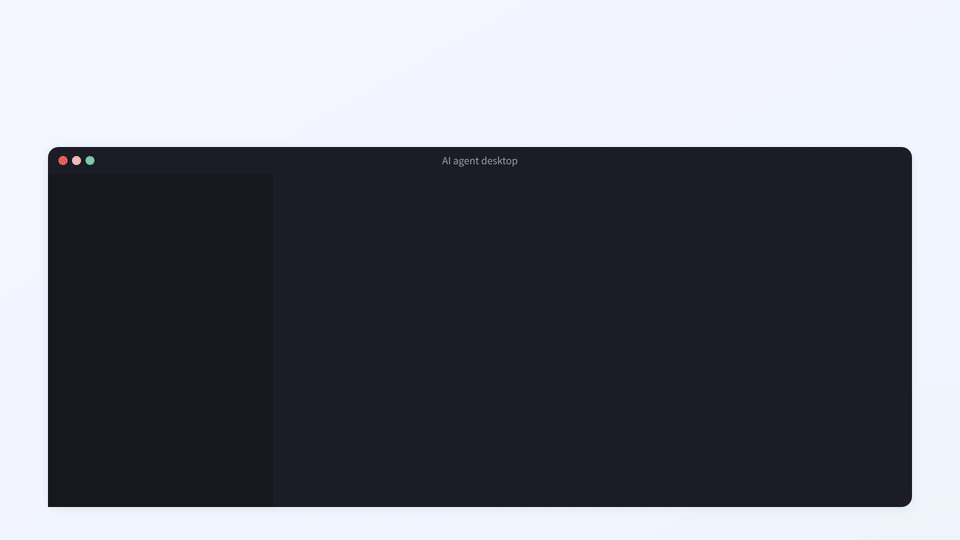
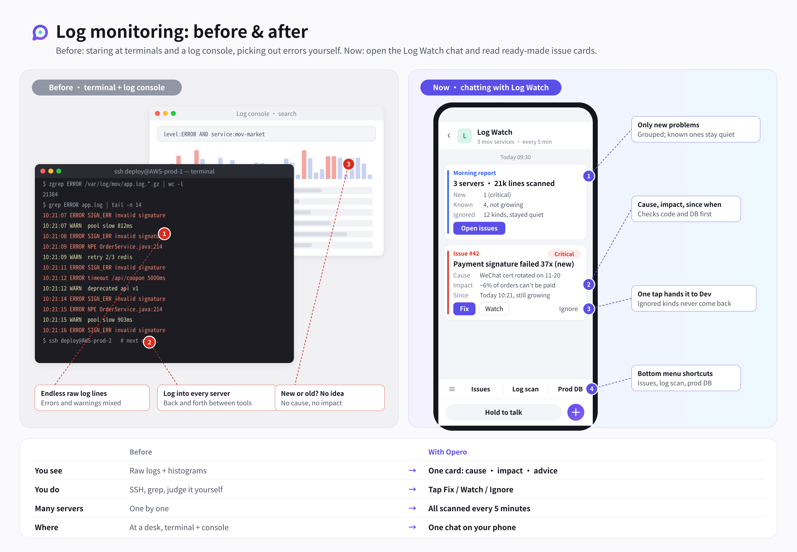
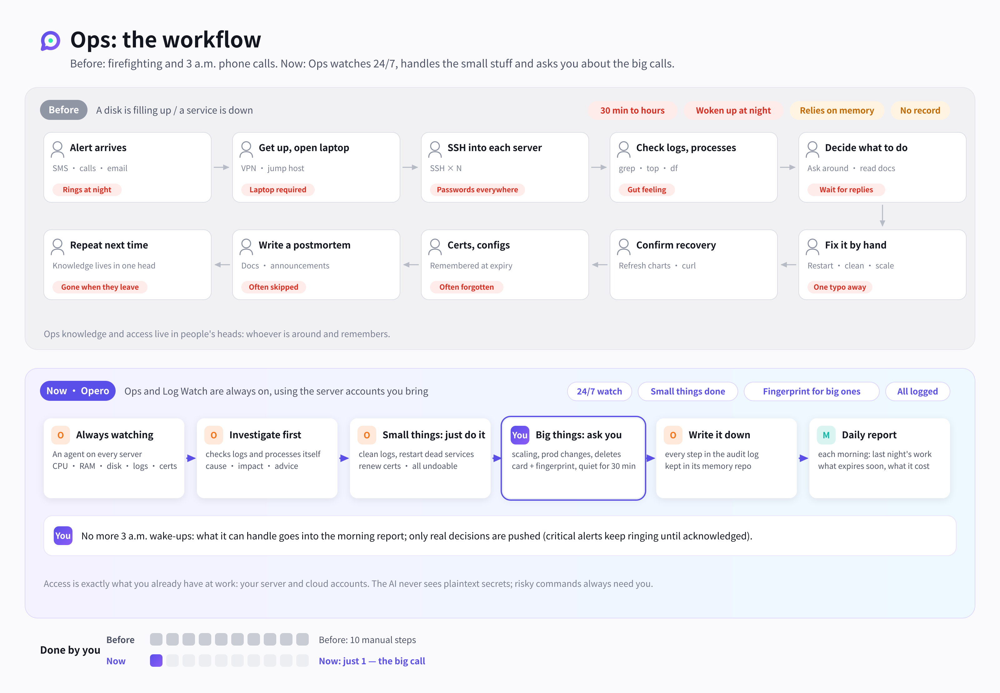
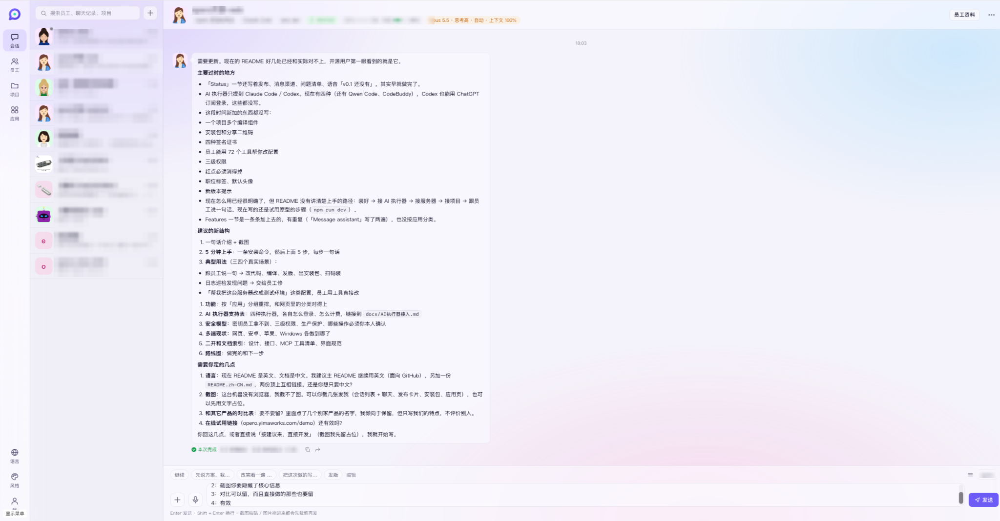
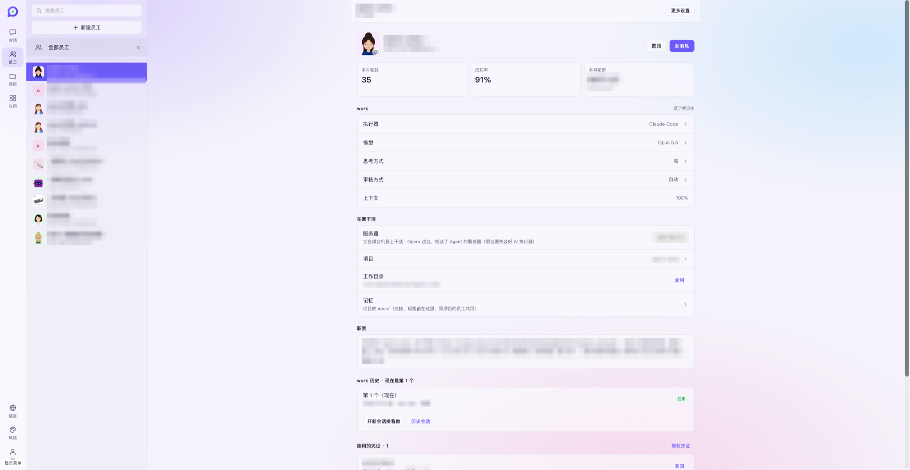
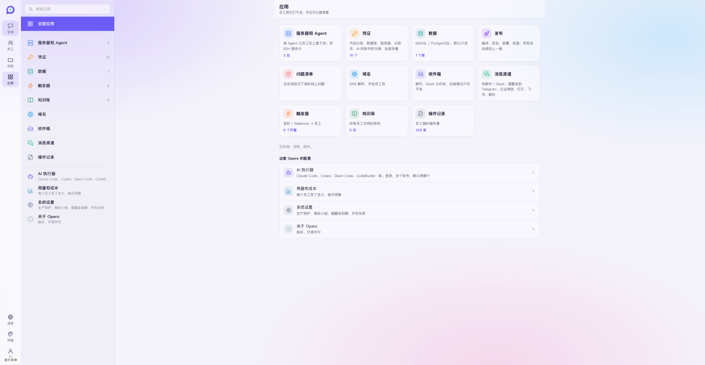

**Your self-hosted AI dev team, in a chat app.**
Claude Code, Codex, Qwen Code and CodeBuddy employees that catch bugs, fix code, ship releases and run ops — all from your phone.

**English** · [简体中文](README.zh-CN.md) · **[Live demo](https://opero.yimaworks.com/demo)** · [Website](https://opero.yimaworks.com)

   



---

Opero is a **self-hosted, single-user AI agent workspace** for developers: a small team of **AI employees** runs your day-to-day engineering — **log monitoring, bug fixing, releases and ops (AI SRE)**. Each employee is a real **coding agent** (Claude Code, Codex, Qwen Code or CodeBuddy Code) running on your own servers with **the access you already have at work**, and you talk to all of them in one chat app — think *a personal AI agent like OpenClaw, but built to ship and operate your code*.

- **One person, one instance.** No accounts, roles or approval chains. Opero is *your* dev team.
- **Your access, brought in.** Whatever servers, repos, databases and cloud accounts you can use at work, your employees can use — nothing more. The AI never sees plaintext secrets; anything that loosens security needs you in person (human-in-the-loop by design).
- **Everything happens in the chat.** Say one sentence; employees configure builds, release targets, servers, budgets and settings with their own tools. Pages are for looking and for the occasional tap.
- **Hackable — built to be forked.** Change menus, cards, themes and employees; every app feature also has an MCP tool, so an employee can make the change for you.

## Why Opero




## What changes

Opero doesn't add another dashboard. It replaces the IDE + terminal + dozen web consoles you juggle every day with a chat: **employees investigate and do the work; you read conclusions and make decisions.**

### Log monitoring

Instead of grepping logs after something breaks, the **Log Watch** employee scans every server every 5 minutes, groups and dedupes errors, finds the cause, and sends you an issue card — *Fix*, *Known* or *Ignore 7 days*.



### Bug fixing

Send a screenshot and one sentence. The **Dev** employee reproduces the bug, fixes it, runs the checks and pushes. One more sentence and it ships: the release card shows every step live, health-checks the result and rolls back automatically if something breaks.


### Ops (AI SRE)

The **Ops** employee watches your servers. Small things (clean old logs, restart a dead service, renew a certificate) are handled and reported — every file it writes is backed up first. Anything that touches production or loosens a guard rail waits for you.


<details>
<summary><b>The workflows, step by step</b></summary>




</details>

## Screenshots

Real screens from our own instance (project names, servers, costs and repository addresses are blurred). The UI speaks 7 languages; these are in Chinese.

| Chat with an employee | An employee's profile | Apps |
|---|---|---|
|  |  |  |

## Get started in 5 steps

1. **Install** on a Linux server: let Claude Code / Codex follow [INSTALL.md](INSTALL.md), or run the one-line installer (see [Install](#install)). Open `http://<server>:7300` and create the owner account.
2. **Connect an AI executor** (Apps → AI executors): one click installs Claude Code, Codex, Qwen Code or CodeBuddy Code; then sign in with a subscription (Claude Pro / Max, ChatGPT Plus / Pro…) or paste an API key. Step-by-step for each: [docs/AI执行器接入.md](docs/AI执行器接入.md).
3. **Connect servers** (Apps → Servers & Agent): generate a one-line Agent install command and run it as root on each server. The Agent only connects outward — no open ports.
4. **Add a project**: paste a repository URL and a token. Opero clones it and creates a project employee that already knows the code, the docs and the handoff notes.
5. **Say one sentence** in the chat: *"set up build and release for this project"*, *"fix the bug in this screenshot"*, *"add a test environment on web-02"*. The employee does it with its tools and reports back; you only tap where a decision is yours.

## Everyday use

What you say → what happens:

- *"The login page shows a blank screen on iPhone, here's a screenshot."* → the Dev employee reproduces, fixes, commits and pushes; a run summary shows the changed files with an *Undo* button.
- *"Ship it to test."* → a release card appears and updates live: build (local or Yunxiao / GitHub Actions / GitLab CI / Jenkins pipeline), verify the artifact, sign, deploy, health check — with *Roll back* if needed.
- *"Build the Android app for testers."* → the APK is built, signed and dropped into the project's **packages**; *Share* gives a QR code testers scan to install.
- *"Make web-02 a test server and let the Ops employee use the Cloudflare token."* → done with MCP tools; the second part loosens security, so a card asks you to confirm in person.
- Something needs you? A bar at the top of the chat says what it is, with *Show me* and *Later*. Every red dot can be cleared from where you see it.

## How it works

| | |
|---|---|
| **Employees** | Each employee has a name, a position tag and a long-running *work*: a coding agent (Claude Code / Codex / Qwen Code / CodeBuddy Code) on one of your servers, with its role, model, thinking effort and review mode. Project employees keep their memory in the project's `docs/` (handoff notes, rules). When the context fills up it writes a handoff and starts a fresh work; nothing is lost. |
| **Chat + cards** | Employees answer in Markdown and post **cards**: confirm, ask, issue, run summary, release (live step timeline), credential request. A card button is an action, so the same card works on web, desktop and mobile. |
| **MCP at the core** | 72 tools for employees ([full list](docs/api/MCP工具.md)): servers, databases, builds, releases, packages, DNS, inbox, schedules, credentials, budgets, settings… Every app feature has a tool. Each tool has a level: **read** runs directly, **write** follows the employee's review mode, **owner** (loosening security, deleting, raising budgets) always needs you in person. |
| **Agent** | A small agent on each server connects *outward* — no open ports. Employees run there; logs, metrics, deploy directories and builds are local to that machine. |
| **Safety** | Secrets live in an encrypted vault; employees use them by name (`{{secret:name}}`) and never see values. Production servers and databases are protected; every change is audited and attributed to the employee that made it. |
| **Knowledge** | Your habits are injected into every task; shared specs and runbooks live in the knowledge base and are queried on demand; project rules come from the repo's `CLAUDE.md` / `AGENTS.md` and `docs/`. |

## How Opero compares

| | Opero | Coding-agent remotes<br>(T3 Code, Orca, RemoteCC) | Personal AI agents<br>(OpenClaw, Hermes) | AI SRE agents<br>(HolmesGPT, OpenSRE) | AI workforce platforms<br>(Paperclip, Workforce) |
|---|---|---|---|---|---|
| Drive Claude Code / Codex from your phone | ✅ | ✅ | — | — | — |
| Also Qwen Code / CodeBuddy, subscriptions or API keys | ✅ | — | — | — | — |
| A team of long-running employees with roles and memory | ✅ | — | one assistant | — | ✅ |
| Finds bugs from logs on its own | ✅ | — | — | ✅ | — |
| Fix → checks → release → rollback in one chat | ✅ | partial | — | partial | — |
| Builds and signs app packages, share by QR code | ✅ | — | — | — | — |
| Employees change settings for you, loosening needs you | ✅ | — | — | — | approvals |
| Cards with buttons instead of walls of text | ✅ | — | — | — | — |
| Uses *your* existing access, never sees secrets | ✅ | — | — | partial | approvals |
| Self-hosted, single user, fork-and-hack | ✅ | ✅ | ✅ | ✅ | team-oriented |

## Features

**Chat**
- WeChat-like sessions: pinned chats, mute, voice input, drag-and-drop and paste images; every image goes through an editor (crop / rotate / adjust) first.
- Interject while an employee is working, or queue the message; quick phrases; per-chat search; drafts survive page switches and reloads.
- Red dots only for things that need you, and every one can be cleared where you see it (*Show me* / *Later*); tapping the badge opens the chat that needs you.
- Run summary after each round: changed files, commits, cost, *Undo*, *Release*.

**Employees**
- Name + position tag, 128 default avatars (DiceBear) or your own (cropped), default names in Chinese and English.
- Work settings in place: executor, model, thinking effort, review mode (automatic / ask before commands / ask every step / plan only), which account to use.
- Switch executor (Claude Code ↔ Codex ↔ Qwen Code ↔ CodeBuddy) with an automatic handoff; move an employee to another server; hand work to each other (`delegate`).
- Edit everything where it's shown: click a name, a role, an avatar.

**AI executors**
- Claude Code, Codex, Qwen Code, CodeBuddy Code — one-click install on Opero's machine or any Agent server.
- Several accounts per executor: Claude subscription login or setup-token, Codex sign-in with ChatGPT (device code) or `auth.json`, API keys with custom endpoints; default account, per-employee account, automatic failover when an account hits its usage limit.
- Network egress through another server when the AI provider is unreachable from yours.

**Projects, builds and releases**
- Projects from GitHub, GitLab, Gitee, Codeup or any Git; branches, auto commit & push after each round, PRs/MRs.
- Several build components per project (web, Android, Java, Go…), built locally or on Yunxiao, GitHub Actions, GitLab CI or Jenkins — pipelines generated for you; test builds with readable failure logs (compiler errors first).
- Release environments (production / staging / test / dev) to one or more servers: verify, sign, deploy script, health check, automatic rollback, one-click rollback; employees may release directly, ask you first, or not at all.
- **App packages**: one slot per platform (Android / iPhone / Mac / Windows / Linux) × test / production, latest only; drop files in, or let a release store them; share links with QR codes.
- **Signing certificates**: Android keystore (signed automatically), Apple certificate (.p12 + profile), App Store Connect API key, Windows code signing (.pfx).

**Servers, data and ops**
- Servers via Agent (or SSH): health, logs viewer, directories employees may read or deploy to, rules per server (commands denied, memory cap, builds allowed).
- Log patrol → issue list that merges repeats; issue cards: fix / known / ignore.
- Databases (MySQL, MariaDB, PostgreSQL, SQL Server, Oracle): read-only by default, protected production, saved queries.
- Credentials with step-by-step guides and a direct link to where you get each token; tested on save; granted per employee.
- DNS on Cloudflare or Alibaba Cloud for the domains you grant; write files with automatic backup.

**Everything else**
- Inbox: email (IMAP) and Slack sorted into needs-you / FYI / not important, reply suggestions in the sender's language — never sends on your behalf.
- Reminders to Telegram, Slack, WeCom, DingTalk, Feishu, email or a signed webhook.
- Schedules and webhooks that wake an employee; shared knowledge base; operation log.
- Usage and budgets per employee, per project and overall.
- Passkeys and TOTP two-step login; verify-it's-you for risky actions.
- 14 themes + your own colors, light / dark; 7 languages (简体中文, 繁體中文, English, 日本語, Deutsch, Français, العربية); a living logo that shows when employees work or something waits for you; a new-version card when Opero is updated.

## AI executors

| Executor | By | Sign in | Pays with | Needs egress from China |
|---|---|---|---|---|
| Claude Code (recommended) | Anthropic | Claude account (Pro / Max), setup-token, or API key | subscription or pay-as-you-go | yes |
| Codex | OpenAI | ChatGPT account (device code), `auth.json`, or API key | ChatGPT plan or pay-as-you-go | yes |
| Qwen Code | Alibaba (Tongyi) | Bailian API key | pay-as-you-go | no |
| CodeBuddy Code | Tencent | CodeBuddy API key (Standard plan or above) | plan credits | no |

Where to get each key, which plans work and what to switch on first: [docs/AI执行器接入.md](docs/AI执行器接入.md).

## Security model

- **Secrets never reach the AI.** The vault is encrypted and readable only by the backend user; employees run as a separate user and refer to secrets by name.
- **Three levels for every tool.** Read runs directly; writes follow the employee's review mode; anything that loosens security (production protection off, database writes, granting credentials, deleting, raising budgets, fewer reminders, your habits) always needs you in person — employees cannot do it alone.
- **Production is protected.** Servers and databases tagged production ask before changes; releases to production need you to verify it's you.
- **Hard limits.** No sudo, no system installs, no `curl | sh`, no wiping disks — whatever the review mode.
- **Everything is audited**, attributed to the employee (and whether it came through MCP).

## Clients

| Client | Status |
|---|---|
| Web (desktop and mobile browsers) | ✅ the main client; also the live demo |
| Android (`code/android`) | 🚧 native rewrite in progress (sessions and chat native, other pages embedded); 0.4.0 |
| iPhone / iPad / Mac (`code/apple`) | 📝 planned (SwiftUI) |
| Windows (`code/windows`) | 📝 planned (WinUI 3) |
| Desktop (`code/desktop`) | interim Electron app: tray and notifications |

Every client signs in on its own; architecture: [docs/多端架构.md](docs/多端架构.md).

## Status

Opero is at an **early stage** — we use it every day to build Opero itself, and open-source it as we go.

- ✅ Backend (`code/server`, Node 22 + TypeScript + SQLite) and web UI (`code/web`, React 19 + Vite): everything in the feature list above.
- 🚧 Native Android; saved flows (rerun what an employee did without AI); plugins.
- 📝 Next: Apple and Windows native apps; the Agent on macOS / Windows (so Apple / Windows packages build and sign in Opero too); a generic ACP driver for more agents (Kimi Code, Goose, Copilot CLI…).

Most docs are in Chinese for now; English versions will follow.

## Try it

- **Live demo:** [opero.yimaworks.com/demo](https://opero.yimaworks.com/demo) — the full UI on mock data; it connects to nothing.
- **Run the UI locally:**

```bash
cd code/web
npm install
npm run dev
```

Open the printed URL, log in with the prefilled demo account, and walk through the onboarding (or skip it).

## Install

Opero runs on **your own server**, because employees need a machine to work on.

1. Get a Linux server with systemd (Ubuntu / Debian / RHEL family, 2 vCPU / 4 GB+). A domain is recommended.
2. **Let your AI install it.** Open Claude Code or Codex on that server and say:
   > Install Opero on this server by following https://github.com/yimaworks/opero/blob/main/INSTALL.md

   It checks the server, runs the installer, fixes problems and tells you the address. To do it yourself, run as root:
   ```bash
   curl -fsSL https://raw.githubusercontent.com/yimaworks/opero/main/code/server/scripts/install.sh | sudo bash
   ```
   Or, from a clone of this repository: `sudo bash code/server/scripts/install.sh`. See [INSTALL.md](INSTALL.md). Add `--cn` to download Node and npm packages from mirrors in China.
3. Open `http://<server-ip>:7300`, create the owner account, and follow the setup wizard: it installs and signs in an AI executor with buttons, then creates your first employees.

What the installer sets up:

| Path / user | What |
|---|---|
| `/opt/opero` | Node 22 and the app |
| `/etc/opero/opero.env` | port, directories, AI user |
| `/var/lib/opero` | database, vault key, files, app packages (readable by `opero` only) |
| `/srv/opero/work` | projects (repos) where employees work |
| user `opero` | runs the backend (`systemctl status opero`) |
| user `opero-ai` | runs the AI executors. It cannot read `/var/lib/opero`, so the AI never sees your credentials. |

For production, put nginx with HTTPS in front — `code/server/scripts/nginx.conf` includes the larger upload limit for app packages. Daily commands: `opero status`, `opero logs`, `sudo opero update`, `opero reset-password`. Everything comes from GitHub, nodejs.org and npm.

**Run it locally for development** (no isolation, so the AI user is your own user):

```bash
cd code/web && npm install && npm run build
cd ../server && npm install && npm start   # http://127.0.0.1:7300
cd ../server && npm test                    # backend tests
```

## Repository layout

```
code/server          Backend (Node 22, TypeScript run directly, node:sqlite), MCP server, Agent, installer
code/web             Web UI (React 19 + Vite + TypeScript); the same build is the live demo
code/android         Android app (Kotlin + Jetpack Compose)
code/apple           iPhone / iPad / Mac app (SwiftUI, planned)
code/windows         Windows app (C# + WinUI 3, planned)
code/desktop         Interim desktop app (Electron)
docs/                Design and specs (start with docs/设计.md); docs/api for the API and MCP tools
```

## Customizing Opero (二开)

Opero is designed to be forked and changed — and since every app feature has an MCP tool, you can ask an employee to do it.

- **Docs to start from:** [design](docs/设计.md) · [API](docs/api/README.md) · [MCP tools](docs/api/MCP工具.md) · [cards](docs/规范/表单与卡片.md) · [UI rules](docs/规范/界面.md) · [clients](docs/多端架构.md) · [AI executors](docs/AI执行器接入.md) · [changelog](docs/变更记录.md)
- **Bottom menus** — register a menu in `code/web/src/menus.ts`; see `docs/规范/底部菜单.md`.
- **Cards** — one JSON description, one renderer; see `docs/规范/表单与卡片.md`.
- **Themes** — add one entry to `code/web/src/themes.ts`.
- **Tools** — add a tool in `code/server/src/tools.ts` (reuse the web API through `callApi`, pick read / write / owner), then run `node code/server/scripts/mcp-list.mjs`.

## Contributing

Issues and pull requests are welcome. Please open an issue first for larger changes.

## Keywords

AI dev team · AI employees · coding agent · Claude Code · Codex · Qwen Code · CodeBuddy · ACP · MCP · personal AI agent · self-hosted · AI SRE · AIOps · ChatOps · DevOps · human-in-the-loop · agent orchestration · mobile

## License

[Apache-2.0](LICENSE)
