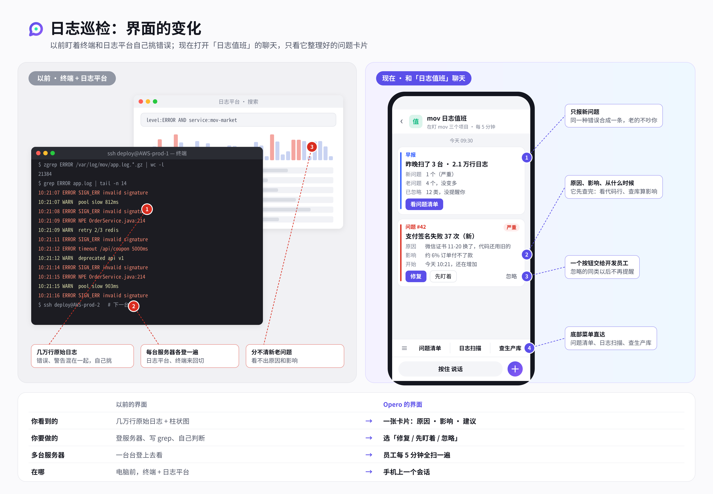
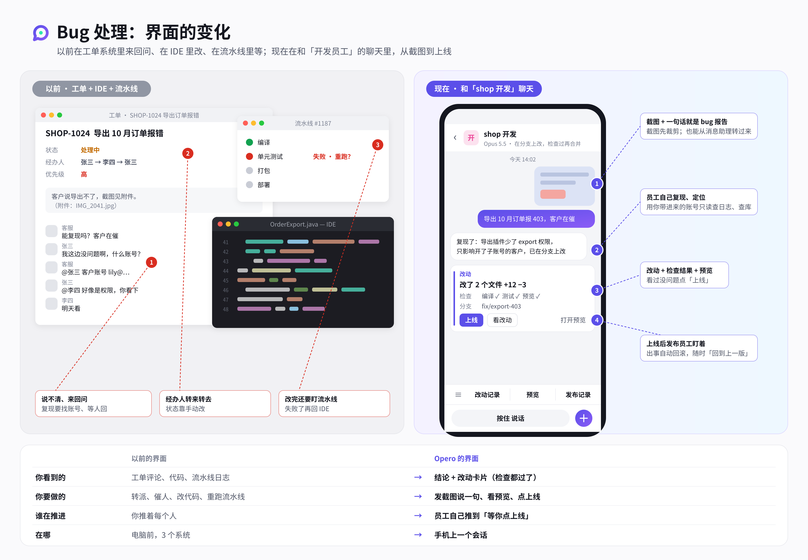
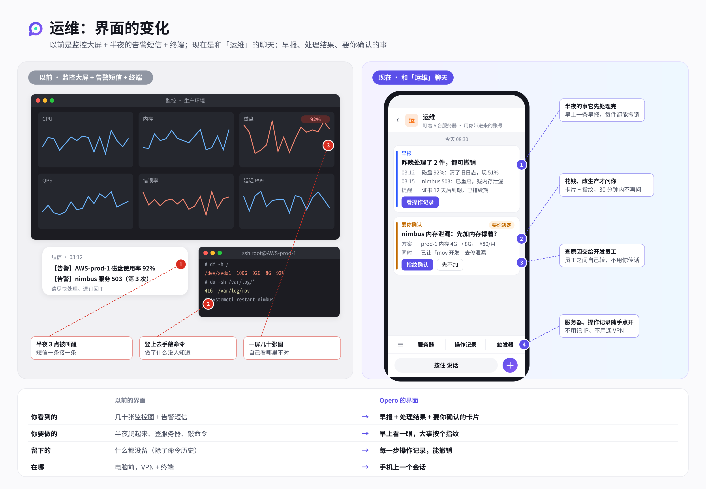
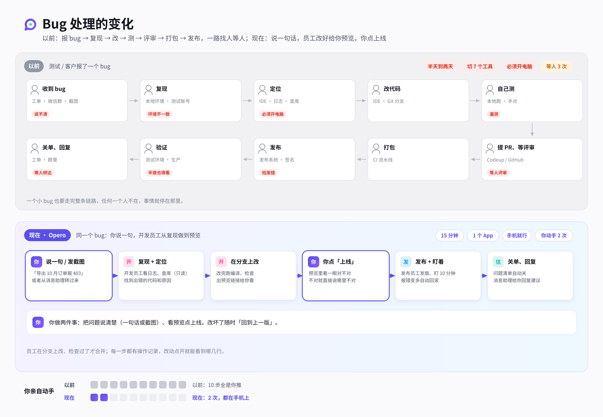
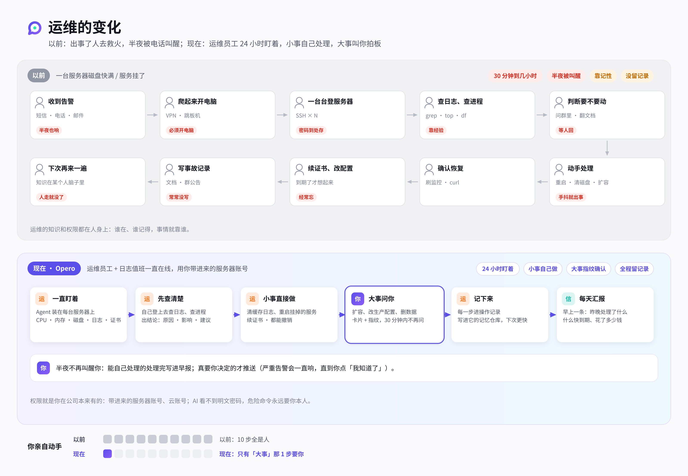

**你自己部署的 AI 开发团队，装在一个聊天 App 里。**
Claude Code / Codex 员工替你查 bug、改代码、发版本、管运维，手机上就能搞定。

[English](README.md) · **简体中文** · **[在线试用](https://opero.yimakeji.cn/demo)** · [官网](https://opero.yimakeji.cn)

   


---

Opero 是一个面向开发者的**自己部署、只有你一个人用的 AI Agent 工作台**：一组 **AI 员工**替你跑日常研发——**日志巡检、修 bug、发版本、运维（AI SRE）**。每个员工都是真正的**编码 Agent**（Claude Code、Codex，或任何支持 ACP 的 Agent），跑在你自己的服务器上，用的是**你在公司本来就有的权限**；你在一个聊天 App 里和它们说话。可以理解成：*像 OpenClaw 那样的个人 AI 助理，但专门替你写代码、发版本、管线上。*

- **一人一套。** 没有账号、角色、审批流程，Opero 就是*你的*开发团队。
- **权限是你带进来的。** 你在公司能用哪些服务器、代码仓库、数据库、云账号，员工就能用哪些，不会更多。AI 看不到明文密码；危险操作永远要你本人指纹确认（人在回路里）。
- **生来就是给你二开的。** 改菜单、加插件和卡片、加主题、写自己的员工；Opero 自带的「后台开发」员工可以替你改，先给预览再上线。

## 为什么做 Opero


## 有什么变化

Opero 不是又一个后台。它把你每天来回切的 IDE、终端和一堆网页控制台，换成一个聊天：**员工去查、去做；你看结论、做决定。**

### 日志巡检

不用等出事了再去翻日志。「日志值班」员工每 5 分钟扫一遍所有服务器，同类错误合成一条、查清原因，给你一张问题卡片：*修复*、*先盯着* 还是 *忽略*。



### Bug 处理

发一张截图、说一句话。「开发」员工自己复现、在分支上改、跑完检查，给你预览。你点*上线*，「发布」员工发版并盯着，报错变多自动回滚。



### 运维（AI SRE）

「运维」员工 24 小时盯着服务器。小事（清旧日志、重启挂掉的服务、续证书）自己处理，早上一条早报告诉你，每一步都能撤销；花钱、改生产的事等你按指纹。



<details>
<summary><b>流程对比（一步步）</b></summary>





</details>

## 怎么做到的

| | |
|---|---|
| **员工** | 每个员工是一个常驻的 work：跑在你某台服务器上的编码 Agent（Claude Code / Codex / …），有角色、有自己的 git 记忆仓库、有底部菜单。上下文满了就写好交接换一个 work，什么都不丢。 |
| **聊天 + 卡片** | 员工用 Markdown 回复，并发**卡片**（问题、改动、发布、查询、确认、提问……）。卡片上的按钮就是一次工具调用，网页、桌面、手机用同一套卡片。 |
| **以 MCP 为底** | 所有工具都经过同一个网关（身份 → 判定 → 审计 → 执行），说 MCP。员工之间派活用的也是同一套工具。 |
| **Agent** | 每台服务器（或你自己的电脑）上装一个小 Agent，只主动连出、不开端口；员工在上面跑，日志、监控、部署目录都在本机读。 |
| **安全** | 默认信任 AI，但有护栏：危险操作要你指纹（之后 30 分钟不再问）、生产保护一个开关、所有操作进操作记录并可撤销。 |
| **知识** | 「我的习惯」每次派活自动带上；通用规范、接口文档、运维手册存在 Opero 里，员工通过 MCP 按需查；员工自己的笔记在它的 git 仓库。 |

## 和同类项目比

| | Opero | 手机遥控编码 Agent<br>（T3 Code、Orca、RemoteCC） | 个人 AI 助理<br>（OpenClaw、Hermes） | AI SRE<br>（HolmesGPT、OpenSRE） | AI 员工平台<br>（Paperclip、Workforce） |
|---|---|---|---|---|---|
| 手机上指挥 Claude Code / Codex | ✅ | ✅ | — | — | — |
| 一组常驻员工，有角色、有记忆 | ✅ | — | 一个助理 | — | ✅ |
| 自己从日志里发现 bug | ✅ | — | — | ✅ | — |
| 修复 → 检查 → 上线 → 回滚在一个聊天里 | ✅ | 部分 | — | 部分 | — |
| 卡片 + 按钮，不是一大段文字 | ✅ | — | — | — | — |
| 用你已有的权限，危险操作要指纹 | ✅ | — | — | 部分 | 有审批 |
| 自己部署、单人、随便 fork 二开 | ✅ | ✅ | ✅ | ✅ | 面向团队 |

## 功能

- **像微信一样聊天**：置顶、免打扰、只有要你决定的才红点、按住说话；所有上传图片先过图片编辑器（裁剪 / 旋转 / 调色）。
- **通行密钥和两步验证**：用指纹 / 面容登录（通行密钥），可开两步验证（动态码 + 恢复码）；危险操作前验证本人也能用它们。
- **语音和日志**：说话转文字（App 里用手机自带的语音识别，浏览器里用 Web Speech）；每台服务器能看日志，能过滤、错误标红。
- **消息助理**：邮件、Slack、Telegram 汇到一起，告诉你哪些要你看、为什么，一键回到原处；**不替你回复**，要的话给你回复建议（可多语言），你自己复制。
- **每个员工的 work 设置**：模型、思考方式、审核方式（自动 / 命令要问 / 每步都问 / 只看不改），按员工记住。
- **员工有记忆**：每个员工一个自己的 git 仓库（角色、人设、交接、机器笔记）。开新会话接着做、在 Claude Code 和 Codex 之间换、搬到另一台服务器，都从交接接着干；旧会话还能翻。
- **git 自动化**：开工前把项目变基到远端最新；干完有改动就提交（没做完的标「[未完成]」）并推送，被拒就变基一次再推。git 令牌永远不给 AI。
- **每台服务器的目录**：登记员工能读、能改哪些本地目录，发布能部署进哪些；Agent 用 ACL 只开这些权限。
- **每台服务器的规矩**：允许 / 禁止编译和自测、禁止某些命令、内存上限（一直超就停掉最大的进程）、同时最多几个员工。
- **日志巡检 → 问题清单**：`log_scan`（按分钟统计、第一次 / 最近出现、异常汇总、滚动的 .gz 日志、journald），问题清单自动合并重复的，新的严重问题发卡片：修复（交给对的员工）/ 已知 / 忽略 7 天。
- **运维工具**：改服务器文件自动备份、`{{secret:凭证名}}` 占位让密码不经过 AI。
- **发布**：用现成的模板在云效流水线、GitHub Actions 或你自己的服务器上编译（流水线一键生成），核对过的包发到环境的每台服务器，用包里的部署脚本自己装；发完检查、失败自动回滚、留几个版本一键回滚，顺路给 APK / AAB 签名。员工能发（直接发 / 先问你 / 不许），直接发的失败了会自动交回给员工修。
- **消息助理**：邮件（IMAP）和 Slack 收进一个收件箱，分成要你看 / 知道就行 / 不重要并写一句摘要；回复建议用对方的语言写，从不替你发。
- **提醒发到哪都行**：要你决定的、出错的同时发到 Telegram、Slack、企业微信、钉钉、飞书、邮件或带签名的 Webhook。
- **合并请求和域名**：员工可以在自己的分支上改，在 GitHub、GitLab、Gitee、Codeup 上提合并请求；你开给它的域名，它能改 Cloudflare / 阿里云的解析。
- **知识库和流程**：把员工刚做完的事存成流程，下次不经过 AI 直接跑；可以挂定时或 Webhook。
- **服务器、发布、数据**：服务器状态和只读命令、可回滚的发布、只读查库（MySQL、MariaDB、PostgreSQL、SQL Server、Oracle，写操作留快照）；凭证管理：选分类和类型（代码仓库、数据库、服务器、云账号、AI…），照着分步说明和直达链接去拿令牌，测试连接，再到员工那边逐个授权。
- **14 套风格 + 自己配色**，浅色 / 深色 / 跟随系统，「我」页顶部个性化。
- **桌面端**：一个窗口打开你的 Opero，托盘显示等你处理的数量，系统通知点了直达那个会话（Electron，和手机一样配对）。
- **安卓 App**：原生外壳包着网页界面，带推送、指纹、点通知直达、App 内更新；加功能只发网页，不用发 App。

## 现状

Opero 还在**早期**，边做边开源。

- ✅ **后台 v0.1**（`code/server`，Node 22 + TypeScript + SQLite）：主人登录；和 Claude Code / Codex 员工真聊天（流式、插话、停止）；Opero MCP 代理（SSH 连服务器、查 MySQL / PostgreSQL、Git 同步、审核卡片、知识库、转派）；加密保险箱；定时 / Webhook 触发器；操作记录；用量；安卓外壳配对和推送。
- ✅ **网页**（`code/web`，React + Vite）：同一份打包，官网 /demo 用假数据，装好的一套由后台提供、走真接口。
- ✅ **多语言**：简体中文、繁體中文、English、日本語、Deutsch、Français、العربية。默认跟随系统，选了就同步到所有设备。
- ✅ **安卓外壳**（`code/android`，Kotlin）：代码写好了，还没发布。
- 🚧 **v0.1 还没有**：发布、消息渠道（邮件 / Slack / Telegram）、流程、插件、问题清单、压缩上下文、语音输入。装好的一套里这些显示「还在做」，在线试用里能看到它们的样子。

## 试一下

- **在线试用：**[opero.yimakeji.cn/demo](https://opero.yimakeji.cn/demo)——完整界面，假数据，不连任何服务器。
- **本地跑原型：**

```bash
cd code/web
npm install
npm run dev
```

打开终端里打印的地址，用填好的演示账号登录，走一遍开机向导（也可以跳过）。

## 安装

Opero 要装在**你自己的服务器**上（员工要在服务器上干活），装法像以前那些自己部署的论坛系统：

1. 准备一台有 systemd 的 Linux 服务器（Ubuntu / Debian / RHEL 系，2 核 4G 起），最好有个域名。
2. **让 AI 帮你装。** 在那台服务器上打开 Claude Code 或 Codex，对它说：
   > 按 https://github.com/yimaworks/opero/blob/main/INSTALL.md 帮我在这台服务器上装好 Opero

   它会检查服务器、运行安装脚本、遇到问题自己处理，最后告诉你地址。想自己装，用 root 运行：
   ```bash
   curl -fsSL https://raw.githubusercontent.com/yimaworks/opero/main/code/server/scripts/install.sh | sudo bash
   ```
   或者在拉下来的代码里：`sudo bash code/server/scripts/install.sh`。详细说明见 [INSTALL.md](INSTALL.md)。国内服务器加 `--cn`（Node 和 npm 包走国内镜像），要 Codex 加 `--with-codex`。
3. 打开 `http://服务器IP:7300`：设主人账号。开机向导会帮你一键装好 Claude Code、点按钮登录（打开登录页 → 授权 → 把授权码贴回来），不用再碰命令行。然后建几个员工。

装完的样子：

| 位置 / 用户 | 是什么 |
|---|---|
| `/opt/opero` | Node 22 和程序 |
| `/etc/opero/opero.env` | 端口、目录、AI 用户 |
| `/var/lib/opero` | 数据库、保险箱密钥、文件（只有 `opero` 能读） |
| `/srv/opero/work` | 员工干活的项目 |
| 用户 `opero` | 跑后台（`systemctl status opero`） |
| 用户 `opero-ai` | 跑 Claude Code / Codex，读不到 `/var/lib/opero`，所以 AI 拿不到你的账号 |

正式用建议前面套 nginx + HTTPS（例子：`code/server/scripts/nginx.conf`）。常用命令：`opero status`、`opero logs`、`sudo opero update`（从 GitHub 拉最新代码）、`opero reset-password`。所有东西都从 GitHub、nodejs.org 和 npm 下载，不经过 Opero 官网。

**本机开发时跑起来**（没有用户隔离，AI 就是你自己的用户）：

```bash
cd code/web && npm install && npm run build
cd ../server && npm install && npm start   # http://127.0.0.1:7300
```

## 目录

```
code/server          后台（Node 22，直接跑 TypeScript，node:sqlite）+ 安装脚本
code/web             网页界面（React 19 + Vite + TypeScript）
code/android         安卓 App（Kotlin，逐步原生化；现在是 WebView + 推送 + 指纹）
code/apple           苹果 App：iPhone / iPad / Mac 一套（Swift + SwiftUI，还没开工）
code/windows         Windows App（C# + WinUI 3，还没开工）
code/desktop         桌面端过渡版（Electron：托盘、系统通知）
docs/api             接口文档（各端共用）
code/design-mockups  生成设计图和 Logo 的脚本
docs/                规范和设计文档（从 docs/设计.md 看起）
deploy/              构建、部署脚本
```

## 二开

Opero 就是为了让你 fork 之后随便改：

- **底部菜单**：在 `code/web/src/menus.ts` 注册，见 `docs/规范/底部菜单.md`。
- **卡片**：一份 JSON 描述、一套渲染，见 `docs/规范/表单与卡片.md`。
- **风格**：在 `code/web/src/themes.ts` 加一项。
- **数据层**：页面只从 `code/web/src/store.ts` 读；把假数据换成你的接口，页面不用改。

## 参与

欢迎提 Issue 和 PR；大的改动请先开 Issue 讨论。

## 关键词

AI 开发团队 · AI 员工 · 编码 Agent · Claude Code · Codex · ACP · MCP · 个人 AI 助理 · 自己部署 · AI SRE · AIOps · ChatOps · 人在回路 · Agent 编排 · 手机

## 许可证

[Apache-2.0](LICENSE)
