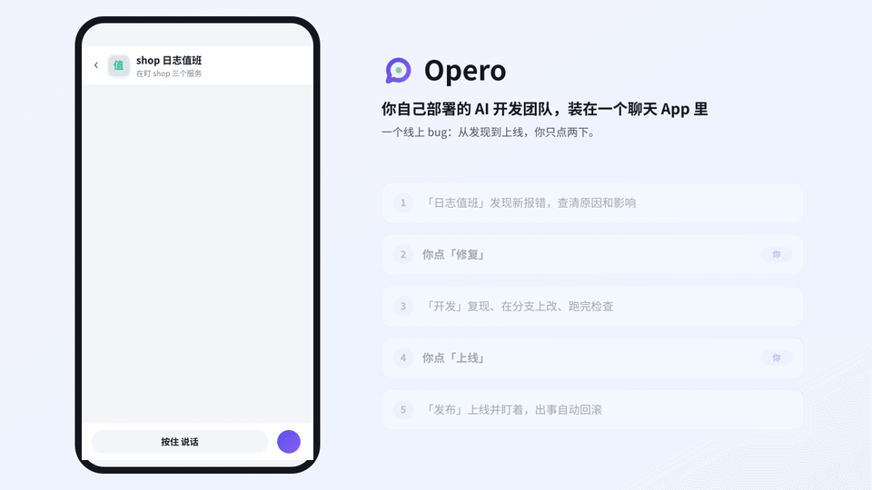
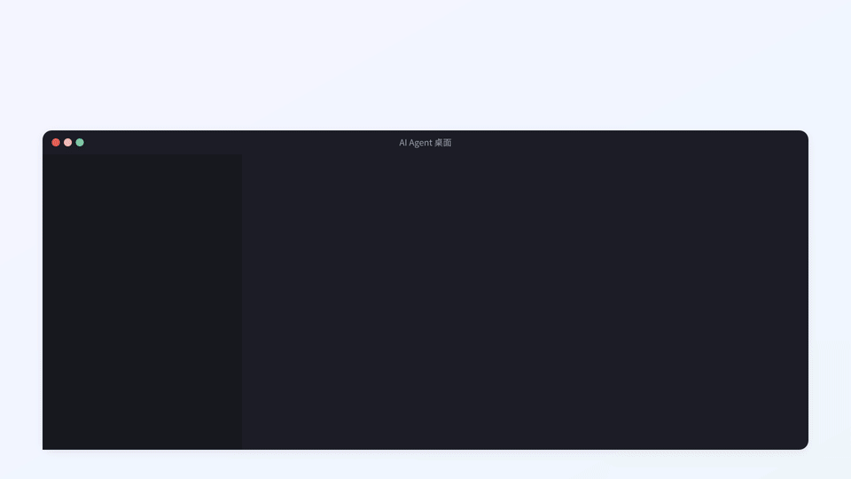
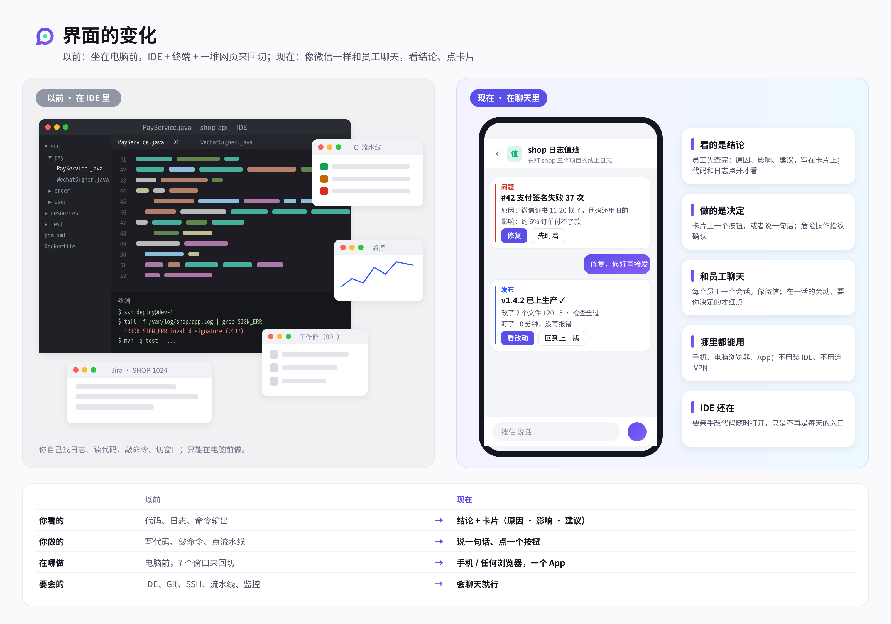
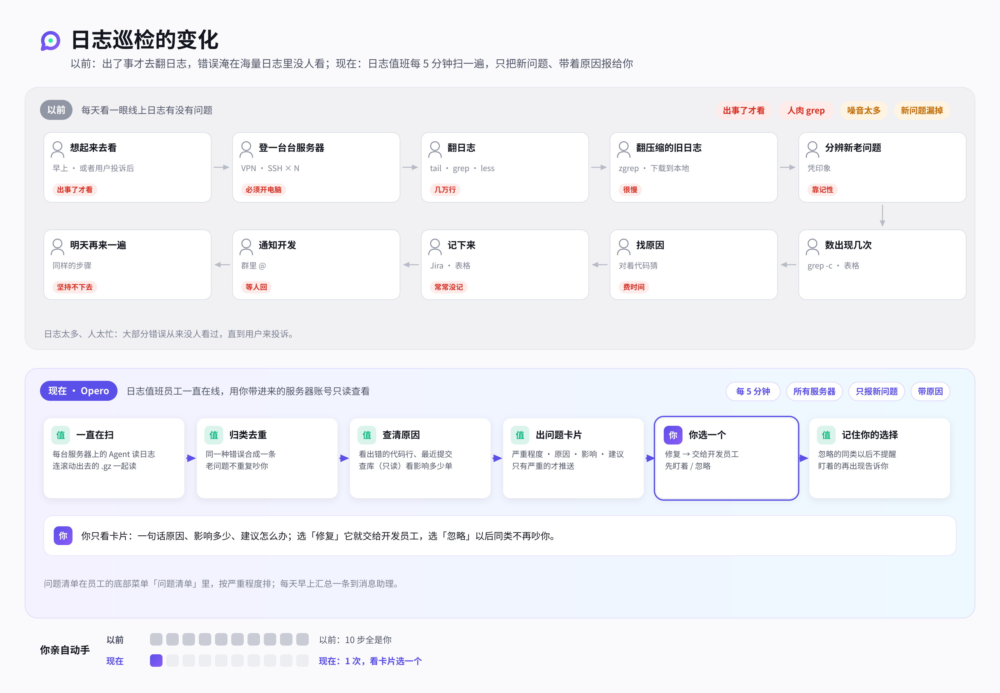
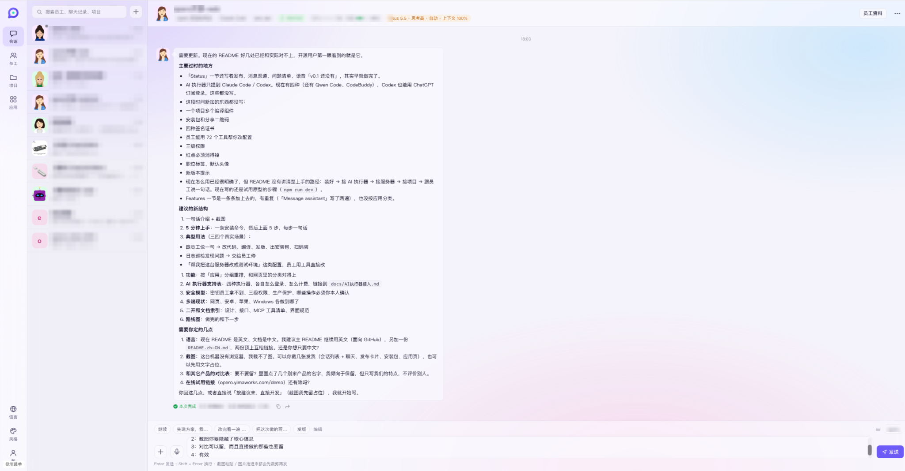
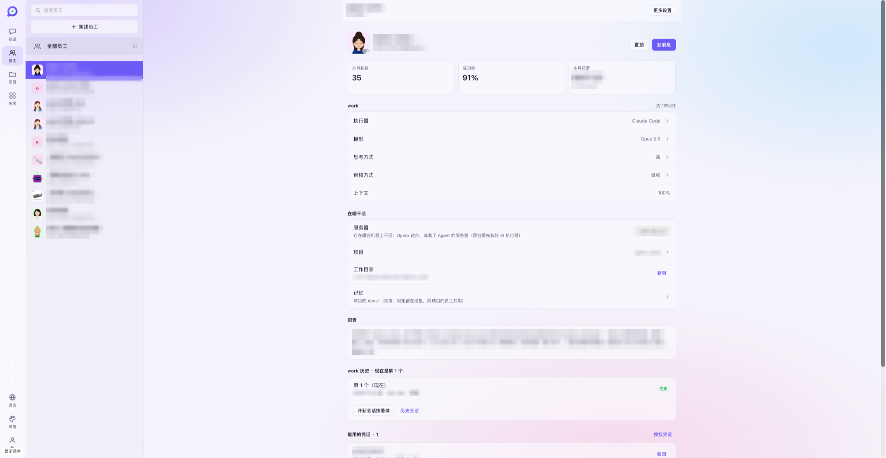
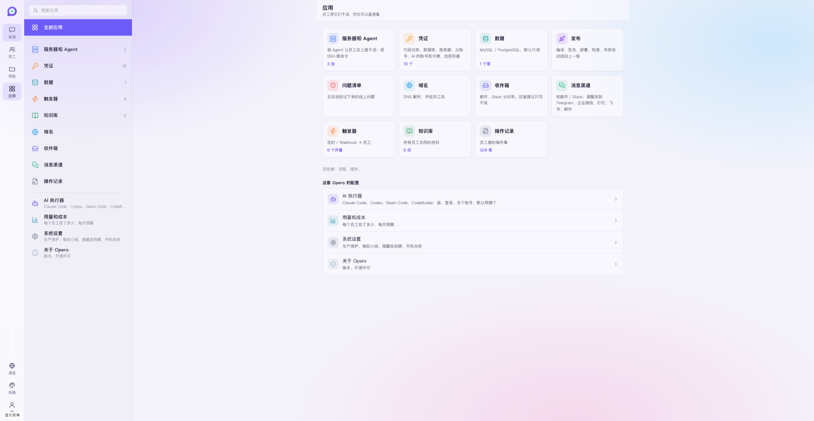

**你自己部署的 AI 开发团队，装在一个聊天 App 里。**
Claude Code、Codex、Qwen Code、CodeBuddy 员工替你查 bug、改代码、发版本、管运维，手机上就能搞定。

[English](README.md) · **简体中文** · **[在线试用](https://opero.yimakeji.cn/demo)** · [官网](https://opero.yimakeji.cn)

   



---

Opero 是一个面向开发者的**自己部署、只有你一个人用的 AI Agent 工作台**：一组 **AI 员工**替你跑日常研发——**日志巡检、修 bug、发版本、运维（AI SRE）**。每个员工都是真正的**编码 Agent**（Claude Code、Codex、Qwen Code 或 CodeBuddy Code），跑在你自己的服务器上，用的是**你在公司本来就有的权限**；你在一个聊天 App 里和它们说话。可以理解成：*像 OpenClaw 那样的个人 AI 助理，但专门替你写代码、发版本、管线上。*

- **一人一套。** 没有账号、角色、审批流程，Opero 就是*你的*开发团队。
- **权限是你带进来的。** 你在公司能用哪些服务器、代码仓库、数据库、云账号，员工就能用哪些，不会更多。AI 看不到明文密码；凡是放宽安全的事都要你本人确认（人在回路里）。
- **一切都在聊天里。** 说一句话，员工用自己的工具配好编译、发布环境、服务器、预算、设置；页面只用来看、偶尔点一下。
- **生来就是给你二开的。** 改菜单、卡片、主题、员工；应用里每个功能都有 MCP 工具，跟员工说一句它就能替你改。

## 为什么做 Opero





## 有什么变化

Opero 不是又一个后台。它把你每天在 IDE、终端和十几个网页控制台之间来回切换，换成一个聊天：**员工去查、去做；你看结论、做决定。**

### 日志巡检

不用等出了事再去翻日志：**日志值班**员工每 5 分钟扫一遍所有服务器，归并去重、找原因，给你发一张问题卡片——*修复*、*已知*、*忽略 7 天*。


### Bug 处理

发一张截图、说一句话。**开发**员工复现、修好、跑检查、推送。再说一句就上线：发布卡片实时显示每一步，发完检查，出问题自动退回上一版。


### 运维（AI SRE）

**运维**员工看着你的服务器。小事（清旧日志、重启挂掉的服务、续证书）直接处理、回头告诉你——写任何文件前先备份。碰生产、要放宽护栏的事，等你来定。


<details>
<summary><b>一步步怎么走</b></summary>




</details>

## 截图

我们自己那套 Opero 的真实界面（项目名、服务器、花费、仓库地址都打了码）。界面支持 7 种语言，这里是中文。

| 和员工聊天 | 员工资料 | 应用 |
|---|---|---|
|  |  |  |

## 5 步上手

1. **装好**：在一台 Linux 服务器上，让 Claude Code / Codex 照着 [INSTALL.md](INSTALL.md) 装，或者跑一条安装命令（见[安装](#安装)）。打开 `http://<服务器>:7300`，建主人账号。
2. **接 AI 执行器**（应用 → AI 执行器）：一键装 Claude Code、Codex、Qwen Code 或 CodeBuddy Code；用订阅登录（Claude Pro / Max、ChatGPT Plus / Pro…）或者贴 API Key。每种怎么弄：[docs/AI执行器接入.md](docs/AI执行器接入.md)。
3. **接服务器**（应用 → 服务器和 Agent）：生成一条 Agent 安装命令，在每台服务器上用 root 跑一下。Agent 只主动连出，不开端口。
4. **接项目**：贴仓库地址和令牌。Opero 拉下代码，建一个项目员工，它已经知道代码、文档和交接。
5. **说一句话**：「把这个项目的编译和发布配好」「修一下截图里这个 bug」「在 web-02 上加一个测试环境」。员工用工具做完告诉你；只有该你决定的地方，你点一下。

## 日常怎么用

你说一句 → 会发生什么：

- 「登录页在 iPhone 上白屏，这是截图。」→ 开发员工复现、修好、提交推送；这一轮的小结写着改了哪些文件，能「撤销」。
- 「发到测试。」→ 出一张发布卡片，实时走：编译（本地，或云效 / GitHub Actions / GitLab CI / Jenkins 流水线）、核对产物、签名、部署、检查——要的话一键「回滚」。
- 「给测试同事出个安卓包。」→ 编好、签好名，放进项目的**安装包**；点「分享」出二维码，测试同事扫码就装。
- 「把 web-02 改成测试服务器，Cloudflare 的令牌给运维员工用。」→ 员工用 MCP 工具改；后半句是放宽安全的，会弹卡片等你本人确认。
- 有事等你？聊天最上面一条提示写着是什么事，配「去看」「以后再说」。每个红点都能在看到它的地方消掉。

## 怎么做到的

| | |
|---|---|
| **员工** | 每个员工有名字、职位标签和一个常驻的 work：跑在你某台服务器上的编码 Agent（Claude Code / Codex / Qwen Code / CodeBuddy Code），带着它的职责、模型、思考方式、审核方式。项目员工的记忆在项目的 `docs/`（交接、规矩）。上下文满了就写好交接换一个 work，什么都不丢。 |
| **聊天 + 卡片** | 员工用 Markdown 回复，并发**卡片**：确认、提问、问题、一轮小结、发布（实时步骤时间线）、要凭证。卡片上的按钮就是一个动作，网页、桌面、手机用同一套卡片。 |
| **以 MCP 为底** | 员工有 72 个工具（[完整清单](docs/api/MCP工具.md)）：服务器、数据库、编译、发布、安装包、域名、收件箱、定时任务、凭证、预算、设置……应用里每个功能都有工具。每个工具一个等级：**只看**直接做，**改动**按员工的审核方式，**放宽安全**（取消保护、删除、调高预算）一律要你本人确认。 |
| **Agent** | 每台服务器上装一个小 Agent，只主动连出、不开端口。员工在上面跑，日志、监控、部署目录、编译都在本机。 |
| **安全** | 密钥在加密的保险箱里，员工按名字用（`{{secret:名字}}`），看不到值。标成生产的服务器、数据库受保护；每个改动都进操作记录，写明是哪个员工做的。 |
| **知识** | 「我的习惯」每次派活自动带上；通用规范、运维手册在知识库里按需查；项目的规矩来自仓库里的 `CLAUDE.md` / `AGENTS.md` 和 `docs/`。 |

## 和同类项目比

| | Opero | 手机遥控编码 Agent<br>（T3 Code、Orca、RemoteCC） | 个人 AI 助理<br>（OpenClaw、Hermes） | AI SRE<br>（HolmesGPT、OpenSRE） | AI 员工平台<br>（Paperclip、Workforce） |
|---|---|---|---|---|---|
| 手机上指挥 Claude Code / Codex | ✅ | ✅ | — | — | — |
| 也能用 Qwen Code / CodeBuddy，订阅或 API Key 都行 | ✅ | — | — | — | — |
| 一组常驻员工，有角色、有记忆 | ✅ | — | 一个助理 | — | ✅ |
| 自己从日志里发现 bug | ✅ | — | — | ✅ | — |
| 修复 → 检查 → 上线 → 回滚在一个聊天里 | ✅ | 部分 | — | 部分 | — |
| 编译、签名 App 安装包，扫码分享 | ✅ | — | — | — | — |
| 员工替你改设置，放宽安全要你本人 | ✅ | — | — | — | 有审批 |
| 卡片 + 按钮，不是一大段文字 | ✅ | — | — | — | — |
| 用你已有的权限，看不到密钥 | ✅ | — | — | 部分 | 有审批 |
| 自己部署、单人、随便 fork 二开 | ✅ | ✅ | ✅ | ✅ | 面向团队 |

## 功能

**聊天**
- 像微信：置顶、免打扰、语音输入、拖进 / 粘贴图片；所有图片先过编辑器（裁剪、旋转、调色）。
- 员工干活时能插话或排队；常用语；聊天记录搜索；没发出去的话换页面、刷新都还在。
- 只有要你处理的事才冒红点，而且都能在看到它的地方消掉（「去看」/「以后再说」）；点「会话」上的数字直接打开等你的那个会话。
- 每一轮做完有小结：改了哪些文件、提交、花费、「撤销」「发布」。

**员工**
- 名字 + 职位标签，128 个默认头像（DiceBear）或自己传（会先裁剪），中英文默认名字。
- work 设置就地改：执行器、模型、思考方式、审核方式（自动 / 跑命令要问 / 每步都问 / 只看不改）、用哪个账号。
- 换执行器（Claude Code ↔ Codex ↔ Qwen Code ↔ CodeBuddy）自动交接；换到别的服务器干活；员工之间转活（`delegate`）。
- 在哪看到就在哪改：点名字、职位、头像就能改。

**AI 执行器**
- Claude Code、Codex、Qwen Code、CodeBuddy Code，在 Opero 这台或任何装了 Agent 的服务器上一键安装。
- 每种都能存多个账号：Claude 订阅登录或 setup-token、Codex 用 ChatGPT 登录（设备码）或 `auth.json`、API Key（可带自己的接口地址）；默认账号、员工指定账号、一个账号用量到上限自动换下一个。
- 服务器连不上 AI 服务商时，经另一台服务器出去（网络出口）。

**项目、编译、发布**
- 项目来自 GitHub、GitLab、Gitee、云效 Codeup 或任何 Git；分支、每轮干完自动提交推送、合并请求。
- 一个项目多个编译组件（网页、安卓、Java、Go…），本地编或走云效、GitHub Actions、GitLab CI、Jenkins——流水线帮你生成；试编译，失败日志把报错的文件和行排在最前面。
- 发布环境（生产 / 预发 / 测试 / 开发）发到一台或多台：核对、签名、部署脚本、检查、失败自动退回、一键回滚；员工可以直接发、先问你、或者不许发。
- **安装包**：每个端（安卓 / iPhone / Mac / Windows / Linux）× 测试 / 正式一格，只留最新；拖进来，或者发布时自动放进来；分享链接带二维码。
- **签名证书**：安卓 keystore（自动签）、苹果证书（.p12 + 描述文件）、App Store Connect API Key、Windows 代码签名（.pfx）。

**服务器、数据、运维**
- 服务器经 Agent（或 SSH）：健康、看日志、员工能读 / 能部署的目录、每台的规矩（不许跑的命令、内存上限、能不能编译）。
- 日志巡检 → 问题清单（重复的合并）；问题卡片：修复 / 已知 / 忽略。
- 数据库（MySQL、MariaDB、PostgreSQL、SQL Server、Oracle）：默认只读、生产受保护、常用查询存起来。
- 凭证：每种都有一步步的指引和直达拿令牌的链接；保存时测一次；按员工授权。
- 域名：Cloudflare、阿里云，只改你开给员工的域名；写文件自动备份。

**其它**
- 收件箱：邮件（IMAP）、Slack 分成要你回 / 知会 / 不重要，回复建议用对方的语言——从不替你发。
- 提醒发到 Telegram、Slack、企业微信、钉钉、飞书、邮件或签名 Webhook。
- 定时任务、Webhook 叫醒员工；共享知识库；操作记录。
- 用量和预算：按员工、按项目、总的。
- 通行密钥、TOTP 两步验证；危险操作验证本人。
- 14 种风格 + 自定义配色，浅色 / 深色；7 种语言（简体中文、繁體中文、English、日本語、Deutsch、Français、العربية）；会动的标志（员工在干活、有事等你时一眼看出来）；Opero 升级后右下角提示新版本。

## AI 执行器

| 执行器 | 谁家的 | 怎么登录 | 怎么付费 | 在国内要不要网络出口 |
|---|---|---|---|---|
| Claude Code（推荐） | Anthropic | Claude 账号（Pro / Max）、setup-token 或 API Key | 订阅或按量 | 要 |
| Codex | OpenAI | ChatGPT 账号（设备码）、`auth.json` 或 API Key | ChatGPT 套餐或按量 | 要 |
| Qwen Code | 阿里（通义） | 百炼 API Key | 按量 | 不用 |
| CodeBuddy Code | 腾讯 | CodeBuddy API Key（标准版及以上） | 套餐积分 | 不用 |

每种的 Key 去哪拿、要什么套餐、先打开什么设置：[docs/AI执行器接入.md](docs/AI执行器接入.md)。

## 安全

- **密钥到不了 AI 手里。** 保险箱加密，只有后台用户能读；员工用另一个系统用户跑，只按名字用密钥。
- **每个工具三个等级。** 只看的直接做；改动按员工的审核方式；放宽安全的（取消生产保护、允许写库、给员工凭证、删除、调高预算、少提醒、改你的习惯）一律要你本人确认——员工自己做不了。
- **生产受保护。** 标成生产的服务器、数据库改东西前先问；发生产要验证本人。
- **硬底线。** 不管审核方式怎么设：不许 sudo、不许装系统软件、不许 `curl | sh`、不许整盘删。
- **所有操作都有记录**，写明是哪个员工做的（以及是不是经 MCP）。

## 多端

| 端 | 现状 |
|---|---|
| 网页（电脑和手机浏览器） | ✅ 主力；也是在线试用 |
| 安卓（`code/android`） | 🚧 原生化进行中（会话和聊天已经原生，其它页嵌网页）；0.4.0 |
| iPhone / iPad / Mac（`code/apple`） | 📝 计划中（SwiftUI） |
| Windows（`code/windows`） | 📝 计划中（WinUI 3） |
| 桌面（`code/desktop`） | 过渡版 Electron：托盘、系统通知 |

每个端都能自己登录；架构见 [docs/多端架构.md](docs/多端架构.md)。

## 现状

Opero 还在**早期**——我们每天用它开发 Opero 自己，边做边开源。

- ✅ 后台（`code/server`，Node 22 + TypeScript + SQLite）和网页（`code/web`，React 19 + Vite）：上面功能列表里的都有。
- 🚧 安卓原生；流程（把员工做过的事存下来，以后不经过 AI 直接跑）；插件。
- 📝 下一步：苹果、Windows 原生 App；Agent 支持 macOS / Windows（苹果、Windows 的包也能在 Opero 里编译签名）；通用 ACP 驱动接更多 Agent（Kimi Code、Goose、Copilot CLI…）。

文档目前大多是中文，英文版陆续补。

## 试一下

- **在线试用：** [opero.yimakeji.cn/demo](https://opero.yimakeji.cn/demo) ——完整界面，假数据，不连任何服务器。
- **本地跑界面：**

```bash
cd code/web
npm install
npm run dev
```

打开打印出来的地址，用预填的演示账号登录，走一遍开机向导（也可以跳过）。

## 安装

Opero 装在**你自己的服务器**上，因为员工要有台机器干活。

1. 准备一台 Linux 服务器，带 systemd（Ubuntu / Debian / RHEL 系，2 核 4G 以上），最好有个域名。
2. **让你的 AI 来装。** 在那台服务器上打开 Claude Code 或 Codex，说：
   > 按 https://github.com/yimaworks/opero/blob/main/INSTALL.md 在这台服务器上装 Opero

   它会检查服务器、跑安装程序、处理问题，最后告诉你地址。想自己装，用 root 跑：
   ```bash
   curl -fsSL https://raw.githubusercontent.com/yimaworks/opero/main/code/server/scripts/install.sh | sudo bash
   ```
   或者在本仓库里：`sudo bash code/server/scripts/install.sh`。详见 [INSTALL.md](INSTALL.md)。加 `--cn` 从国内镜像下 Node 和 npm 包。
3. 打开 `http://<服务器 IP>:7300`，建主人账号，跟着开机向导走：点按钮装好、登录一个 AI 执行器，再建第一批员工。

安装程序会建这些：

| 路径 / 用户 | 是什么 |
|---|---|
| `/opt/opero` | Node 22 和程序 |
| `/etc/opero/opero.env` | 端口、目录、AI 用户 |
| `/var/lib/opero` | 数据库、保险箱密钥、文件、安装包（只有 `opero` 能读） |
| `/srv/opero/work` | 员工干活的项目（仓库） |
| 用户 `opero` | 跑后台（`systemctl status opero`） |
| 用户 `opero-ai` | 跑 AI 执行器。它读不了 `/var/lib/opero`，所以 AI 永远看不到你的凭证。 |

正式用建议前面套 nginx + HTTPS——`code/server/scripts/nginx.conf` 里已经放开了上传安装包要的大小。日常命令：`opero status`、`opero logs`、`sudo opero update`、`opero reset-password`。所有东西都从 GitHub、nodejs.org 和 npm 下。

**本地开发**（不隔离，AI 用户就是你自己）：

```bash
cd code/web && npm install && npm run build
cd ../server && npm install && npm start   # http://127.0.0.1:7300
cd ../server && npm test                    # 后台的测试
```

## 目录

```
code/server          后台（Node 22，直接跑 TypeScript，node:sqlite）、MCP 服务、Agent、安装程序
code/web             网页（React 19 + Vite + TypeScript）；同一份编出来也是在线试用
code/android         安卓 App（Kotlin + Jetpack Compose）
code/apple           iPhone / iPad / Mac App（SwiftUI，计划中）
code/windows         Windows App（C# + WinUI 3，计划中）
code/desktop         过渡版桌面 App（Electron）
docs/                设计和规范（从 docs/设计.md 看起）；docs/api 是接口和 MCP 工具
```

## 二开

Opero 生来就是给你 fork 了改的——而且应用里每个功能都有 MCP 工具，你可以直接让员工去改。

- **从这些文档看起：** [设计](docs/设计.md) · [接口](docs/api/README.md) · [MCP 工具](docs/api/MCP工具.md) · [卡片](docs/规范/表单与卡片.md) · [界面规范](docs/规范/界面.md) · [多端](docs/多端架构.md) · [AI 执行器](docs/AI执行器接入.md) · [变更记录](docs/变更记录.md)
- **底部菜单**——在 `code/web/src/menus.ts` 里登记；见 `docs/规范/底部菜单.md`。
- **卡片**——一份 JSON 描述、一个渲染组件；见 `docs/规范/表单与卡片.md`。
- **主题**——在 `code/web/src/themes.ts` 里加一项。
- **工具**——在 `code/server/src/tools.ts` 里加（用 `callApi` 复用网页接口，选好 read / write / owner），再跑 `node code/server/scripts/mcp-list.mjs`。

## 参与

欢迎提 issue 和 PR。大一点的改动请先开 issue 聊。

## 关键词

AI 开发团队 · AI 员工 · 编码 Agent · Claude Code · Codex · Qwen Code · CodeBuddy · ACP · MCP · 个人 AI 助理 · 自己部署 · AI SRE · AIOps · ChatOps · DevOps · 人在回路 · Agent 编排 · 移动端

## 许可证

[Apache-2.0](LICENSE)
